<div align="center">


<br>

[](https://github.com/Igwe-Starking/eccles-bluechat-e2ee/releases)
[](https://github.com/Igwe-Starking/eccles-bluechat-e2ee/actions/workflows/ci.yml)
[](#install)
[](LICENSE)


### Chat. Call. Video call. No internet. No SIM. No accounts.
**Two phones, one Bluetooth link, and everything you say stays between you.**

[**Download**](https://github.com/Igwe-Starking/eccles-bluechat-e2ee/releases) &nbsp;•&nbsp;
[**Features**](#features) &nbsp;•&nbsp;
[**Security**](#security-you-can-check) &nbsp;•&nbsp;
[**Install**](#install) &nbsp;•&nbsp;
[**Support the build**](#support-the-build)

<br>

<a href="https://paystack.shop/pay/support-bluechat-t1"></a>

</div>

---

## Why Bluechat

Most messengers need data, a SIM, a server and an account. Bluechat needs none of them. When the network is down, expensive, blocked or simply not there, two phones within Bluetooth range can still talk, send photos and voice notes, and make voice and video calls.

| | |
|---|---|
| **Works with zero connectivity** | No mobile data, no Wi-Fi, no SIM. Devices connect directly over classic Bluetooth, about 15 m apart. |
| **End-to-end encrypted** | Every connection runs an authenticated key exchange. Traffic is AES-256-GCM. New in 3.1.0. |
| **Nothing to leak to** | The app does not declare the `INTERNET` permission. It cannot phone home, and CI fails the build if that ever changes. |
| **No accounts, no ads** | No sign-up, no phone number, no tracking, no ad SDK. Ads and billing code were removed in 3.1.0. |
| **Open source** | About 12,000 lines of Java, 96 tests, MIT licensed. Read it, build it, break it. |

<div align="center">

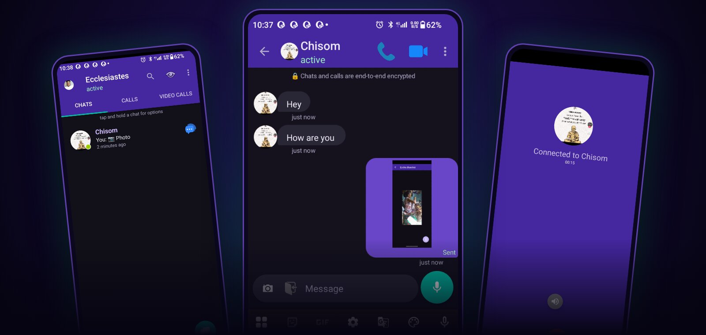

</div>

## See it work

<div align="center">
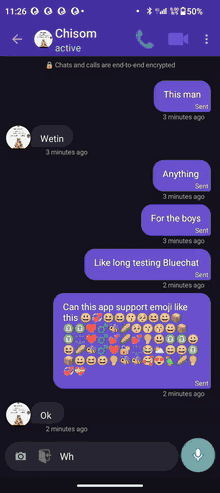
<br>
<sub>Chat, then a video call, sped up 1.75x. <a href="docs/media/demo/bluechat-demo.mp4">Full-quality MP4</a>.</sub>
</div>

## Features

### Messaging
| | |
|---|---|
| **Text with full emoji** | Clean chat bubbles with sent status and friendly timestamps. |
| **Photos, audio and video** | Take one with the camera, or pick a file. It sends automatically. |
| **Voice notes** | Hold the mic to record, slide left to cancel, slide up to lock hands-free. |
| **Unread badges** | Per-chat counters on the Chats, Calls and Video Calls tabs. |
| **Quick reply** | Answer from the notification shade without opening the app. |
| **Drafts** | Half-written messages are kept per contact and shown in the chat list. |
| **Chat actions** | Long-press a chat to Disconnect, Rename, Delete or Block. |

### Calls
| | |
|---|---|
| **Voice calls over Bluetooth** | Leave the call screen and keep using Bluechat while the call continues. |
| **Video calls over Bluetooth** | H.264 video and AAC audio, with a small self-view inset. |
| **Full-screen incoming calls** | A ring screen with your chosen ringtone and answer or decline buttons. |
| **Call history** | Separate Calls and Video Calls tabs. |
| **Bandwidth saver** | Optionally drops other connections while you are on a call, because Bluetooth bandwidth is limited. |

### Connectivity
| | |
|---|---|
| **Device discovery** | Active, Available and Paired lists with live online/offline state. |
| **Go active or offline** | One tap on the eye icon controls whether others can see you. |
| **Multi-connection mode** | Connect to several devices at once (off by default, it costs battery). |
| **Smart Bluetooth** | Turns Bluetooth on when needed and off when you exit, only if Bluechat turned it on. |
| **Scan power saver** | Stops scanning while you are connected to save battery. |

### Privacy and control
| | |
|---|---|
| **App lock** | Fingerprint or device PIN on open and on return from the background. |
| **Screenshot blocking** | While app lock is on, screenshots and screen recording are blocked. |
| **Encrypted on device** | Messages and all chat media are encrypted at rest with Android Keystore keys. |
| **Key-change warnings** | If a contact's identity key changes, the connection is blocked until you decide. |
| **Block list** | Manage blocked devices in Preferences. |
| **Your identity, your photo** | Set a display name and profile photo, shared with people you connect to. |
| **Light and dark** | Follows your system theme, with a manual override. |

## The screens

<table>
<tr>
<td align="center" width="25%">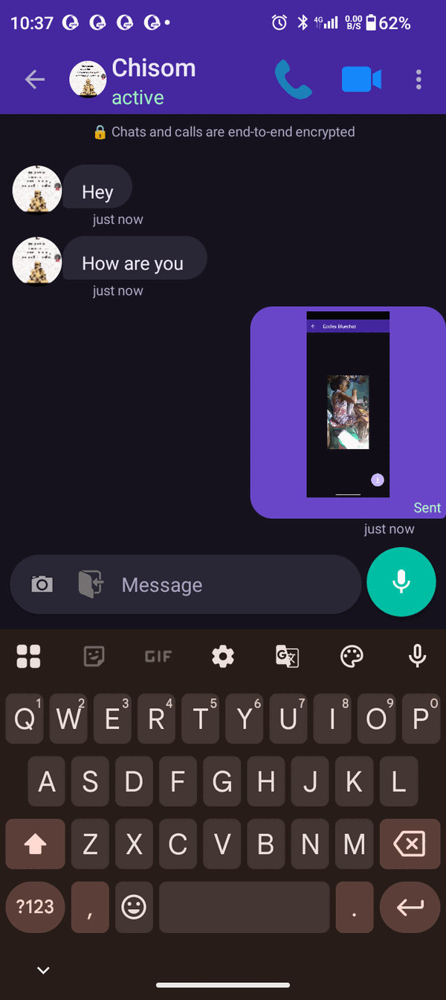<br><sub><b>Encrypted chat</b><br>with the E2EE banner</sub></td>
<td align="center" width="25%">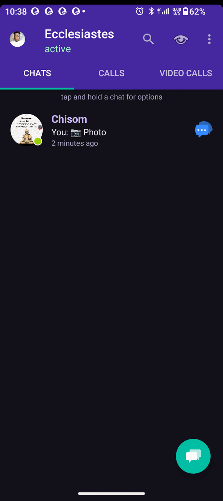<br><sub><b>Chats</b><br>one tap to talk</sub></td>
<td align="center" width="25%">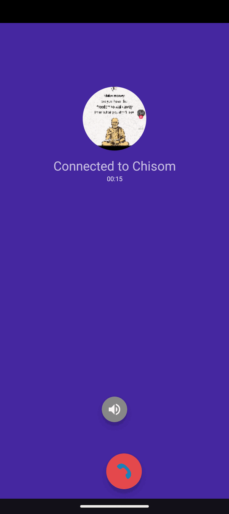<br><sub><b>Voice call</b><br>over Bluetooth</sub></td>
<td align="center" width="25%">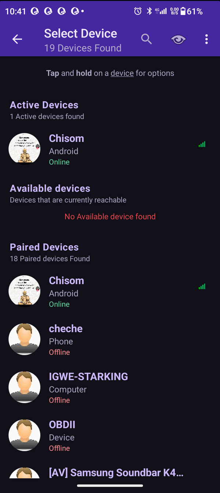<br><sub><b>Device discovery</b><br>active, available, paired</sub></td>
</tr>
<tr>
<td align="center">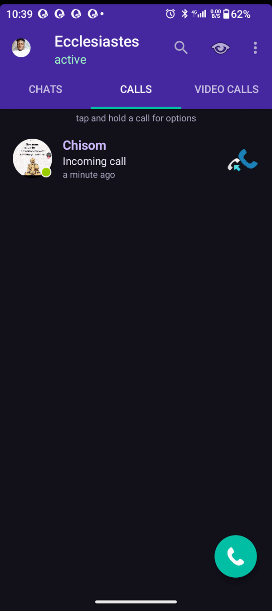<br><sub><b>Call history</b></sub></td>
<td align="center">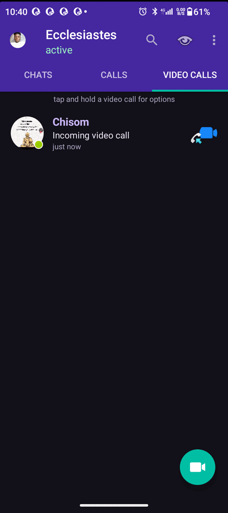<br><sub><b>Video calls</b></sub></td>
<td align="center">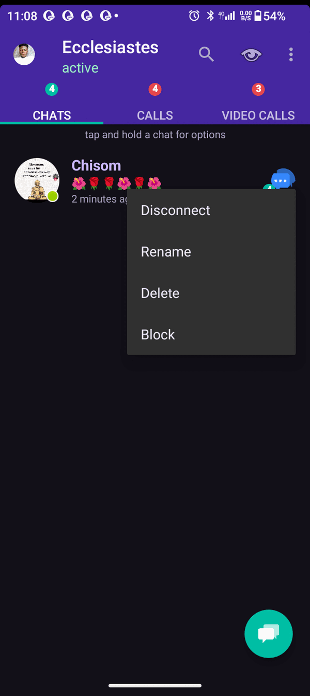<br><sub><b>Chat actions</b><br>disconnect, rename, delete, block</sub></td>
<td align="center">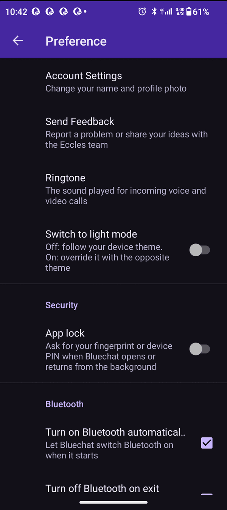<br><sub><b>App lock</b><br>and preferences</sub></td>
</tr>
<tr>
<td align="center">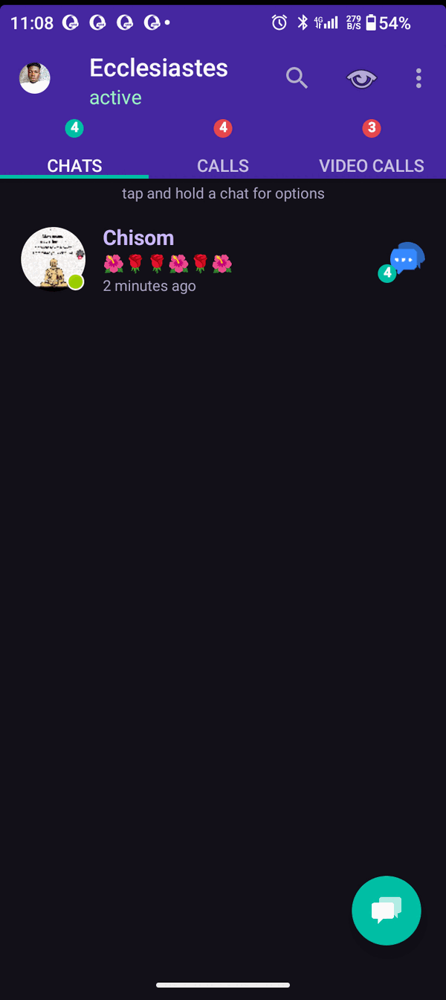<br><sub><b>Unread badges</b></sub></td>
<td align="center"><br><sub><b>Incoming call</b></sub></td>
<td align="center">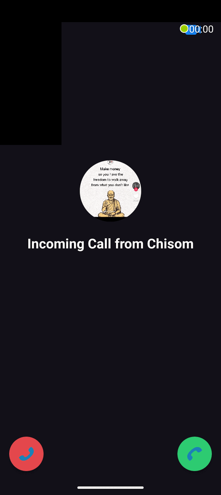<br><sub><b>Incoming call</b><br>dark theme</sub></td>
<td></td>
</tr>
</table>

## Security you can check

Claims are cheap, so here is how to verify them.

```bash
# 1. The shipped APK asks for no network permission
bash scripts/check-no-internet.sh EcclesBluechat-3.1.0.apk

# 2. The file you downloaded is the file that was released
bash scripts/verify-apk.sh EcclesBluechat-3.1.0.apk <sha256 from the release page>

# 3. The crypto test suite passes
bash scripts/test.sh
```

**How a connection is secured** (full detail in [docs/SECURITY_MODEL.md](docs/SECURITY_MODEL.md)):

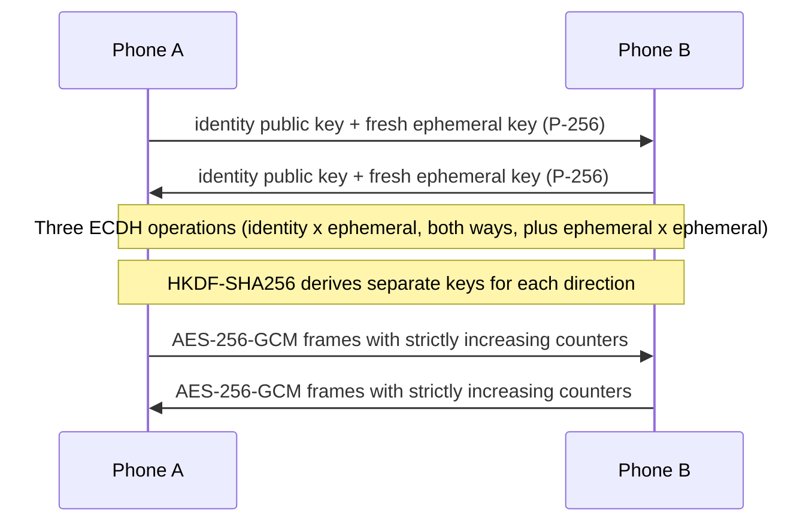

- **Forward secrecy.** Session keys come from fresh ephemeral keys, so a later key compromise does not unlock past sessions.
- **Tamper and replay protection.** Each frame is authenticated by its GCM tag, and out-of-order or replayed frames are rejected.
- **Trust on first use.** The first time you meet a device its identity fingerprint is pinned. If it ever changes, Bluechat stops and warns you. Compare fingerprints in person to defeat a first-contact attacker.
- **Keys at rest.** The identity private key is wrapped by an Android Keystore key and stored outside backups. App backup is disabled.

> **Honest status.** This is custom protocol code that has **not had an independent cryptographic audit**. Treat it as strong engineering that deserves review, not as a certified product. Specific open review items are listed in [docs/SECURITY_MODEL.md](docs/SECURITY_MODEL.md#known-limitations-and-review-items), and expert eyes are very welcome. See [SECURITY.md](SECURITY.md).

## Install

1. Download `EcclesBluechat-3.1.0.apk` from [**Releases**](https://github.com/Igwe-Starking/eccles-bluechat-e2ee/releases).
2. (Recommended) verify it: `bash scripts/verify-apk.sh EcclesBluechat-3.1.0.apk <sha256>`.
3. Open the APK and allow **Install unknown apps** if Android asks.
4. Open Bluechat and grant the permissions it asks for: Nearby devices (Location on Android 11 and older), Notifications, and Microphone or Camera when you first record or call.
5. Do the same on the other phone. Both phones need Bluechat open and within about 15 m.
6. Tap the chat button, pick a device from **Active** or **Available**, and start talking. If Android asks to pair, accept on both phones.

**Requirements:** Android 8.0 (API 26) or newer and Bluetooth. Camera is optional.

**Why not on Google Play?** The developer does not yet have a Play developer account. That is the first thing the [support fund](#support-the-build) is for.

**Updating from an older version:** install over the top. Existing chats are migrated and encrypted automatically.

## Build from source

Everything runs through bash scripts, and CI runs the very same ones.

```bash
git clone https://github.com/Igwe-Starking/eccles-bluechat-e2ee.git
cd eccles-bluechat-e2ee

bash scripts/doctor.sh        # check JDK 17 and the Android SDK
bash scripts/setup-sdk.sh     # accept licenses, install platform 35
bash scripts/ci.sh            # guards + unit tests + debug build
bash scripts/build.sh debug   # just the APK
```

| Script | What it does |
|---|---|
| `scripts/ci.sh [--fast]` | The one command CI runs. `--fast` skips Gradle. |
| `scripts/check-no-internet.sh [apk]` | Fails if INTERNET is requested in source or in an APK. |
| `scripts/check-secrets.sh` | Fails if keystores, keys or `local.properties` are in the tree. |
| `scripts/test.sh` | JVM unit tests. |
| `scripts/build.sh [debug\|release]` | Builds an APK. |
| `scripts/sign-apk.sh` | zipalign and sign from environment secrets. |
| `scripts/release.sh <version>` | Build, sign, verify and checksum into `dist/`. |
| `scripts/verify-apk.sh` | Checksum, signature and no-INTERNET check for a download. |
| `scripts/make-demo.sh` | Rebuilds the README demo from a screen recording. |

Requires JDK 17 and the Android SDK (platform 35). The project uses only AndroidX and Material libraries, with no third-party SDKs.

## Under the hood

| | |
|---|---|
| **Language** | Java, about 12,000 lines in `app/src/main` |
| **Transport** | Classic Bluetooth RFCOMM |
| **Key exchange** | ECDH on P-256, triple-DH with identity and ephemeral keys, HKDF-SHA256 |
| **Session cipher** | AES-256-GCM, per-direction keys, 96-bit nonces from salt and counter |
| **At rest** | AES-256-GCM with Android Keystore keys |
| **Media** | H.264 (AVC) video and AAC audio through `MediaCodec` |
| **Tests** | 66 JVM unit tests plus 30 instrumented tests (Keystore, SQLite) |
| **SDK** | min 26, target 35 |

```
app/src/main/java/starking/eccles/
├── crypto/        handshake, sessions, HKDF, Keystore wrapping, trust store
├── bluechat/      activities, services, Bluetooth transport, preferences, UI
│   └── Interface/ encrypted frame reader and writer
├── data/          encrypted chat database and storage
├── stream/        audio and video encoders and decoders
├── receivers/     Bluetooth and call broadcast receivers
├── Surface/       adapters and list UI
└── util/          drafts, friendly dates, codecs and helpers
scripts/           every executable, all bash
docs/              security model, privacy policy, release notes, media
```

## Roadmap

- [ ] Publish on Google Play (needs a developer account, see below)
- [ ] Independent review of the handshake and framing
- [ ] Encrypt the contact profile-photo store at rest
- [ ] Let CI build signed releases on every tag (already wired, needs signing secrets)

Ideas and bug reports are welcome in [Issues](https://github.com/Igwe-Starking/eccles-bluechat-e2ee/issues).

---

## Support the build

<div align="center">

<a href="https://paystack.shop/pay/support-bluechat-t1"></a>

### [**Support Eccles Bluechat on Paystack →**](https://paystack.shop/pay/support-bluechat-t1)

</div>

I'm Nwobodo Ecclesiastes Chidera (Igwe Starking), a student developer from Nigeria. Bluechat, Eccles Agent and my embedded projects are written, tested and built on a Chromebook that struggles to run Android Studio. Builds are slow, and the Play Store is out of reach because I can't afford a developer account.

**Where your support goes, in order:**

1. **A Google Play developer account**, so Bluechat can reach people who will never find an APK on GitHub.
2. **A proper development laptop**, so builds take minutes, not hours, and I can test on emulators.
3. **Time to keep building**, which means more features, security fixes and open-source releases.

**What I will not do:** gate features, add ads, add tracking or ship an internet permission to make money. The app stays free and offline. Support is a thank-you and a vote for more work like this.

Every amount helps, and none is too small. Paystack handles the payment securely, and I never see your card details.

| Goal | Status |
|---|---|
| Google Play developer account | ☐ not yet |
| Development laptop | ☐ not yet |
| Independent security review of the protocol (stretch) | ☐ not yet |

I update this table by hand when a goal is reached. More detail, transparency notes and free ways to help are on the [**support page**](docs/SUPPORT_THE_PROJECT.md). Supporters who want credit go on the [**Supporters wall**](SUPPORTERS.md).

**Can't give money? These help just as much:**
⭐ Star the repo &nbsp;•&nbsp; 📣 Share it with someone who needs offline chat &nbsp;•&nbsp; 🐛 Report bugs with two devices &nbsp;•&nbsp; 🔐 Review the crypto &nbsp;•&nbsp; 🛠️ Send a pull request

**Need an Android or embedded developer?** I take freelance work in Android (Java), ESP32 and C++. Reach me through my [GitHub profile](https://github.com/Igwe-Starking).

---

<div align="center">

**Eccles Bluechat** · [MIT License](LICENSE) · Built by [Nwobodo Ecclesiastes Chidera](https://github.com/Igwe-Starking)

Also by the same developer: [Eccles Agent](https://github.com/igwe-starking/eccles-agent), an AI phone agent for Android

</div>
