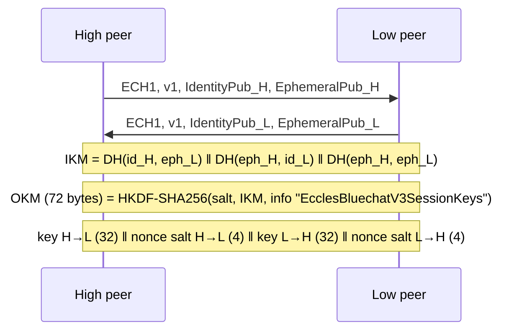

# Eccles Bluechat security model

This document describes what Bluechat 3.1.0 actually does, as implemented in `app/src/main/java/starking/eccles/crypto/`, and where its limits are. If the code and this document disagree, the code is right and this document has a bug. Please open an issue.

> **Status: not independently audited.** The protocol is custom. It uses standard primitives (ECDH on P-256, HKDF-SHA256, AES-256-GCM) from the Android and Java platform, but the way they are combined has not been reviewed by an outside cryptographer. See [Known limitations](#known-limitations-and-review-items).

## Threat model

Bluechat aims to protect the **content** of chats, calls and media between two phones against:

- a nearby attacker who can sniff or inject Bluetooth traffic (passive and active),
- a man in the middle who tries to sit between two devices *after* they have met once,
- someone who obtains a copy of the phone's storage without the device unlocked (at-rest encryption),
- replay and tampering of frames.

It does **not** try to hide *that* two devices are talking, and it cannot protect a phone that is already compromised.

## Identity

- Each install generates one **long-term identity key pair**: EC P-256 (`secp256r1`).
- The private key is wrapped (AES-256-GCM) by a non-exportable **Android Keystore** key and stored in `getNoBackupFilesDir()`, which is excluded from backup. The manifest also sets `allowBackup="false"`.
- A device's **fingerprint** is the SHA-256 of its encoded identity public key, shown as hex groups on the account screen so two people can compare it in person.

## Handshake (every connection)

Both sides send one message, then read the other's:

| Field | Size |
|---|---|
| Magic `0x45434831` ("ECH1") | 4 bytes |
| Version (`1`) | 2 bytes |
| Identity public key length, then X.509 bytes | 2 + n (n ≤ 512) |
| Ephemeral public key length, then X.509 bytes | 2 + n (n ≤ 512) |

Each side generates a **fresh ephemeral P-256 key pair** per connection. Roles are assigned deterministically by comparing the two encoded identity keys (the "high" and "low" peer), so both sides derive the same material without negotiating.

Three ECDH results are concatenated as input keying material:

1. identity key of one side × ephemeral key of the other,
2. the mirror of (1),
3. ephemeral × ephemeral.

Intermediate DH outputs and the IKM are zeroed after use. The handshake runs on a background executor with a **15 second timeout**; on timeout the socket is closed. Locking is **per remote address**, so one stalled peer cannot block other connections.

## Session traffic

- **Cipher:** AES-256-GCM, 128-bit tag, **independent key per direction**.
- **Nonce:** 12 bytes = 4-byte per-direction salt ‖ 8-byte big-endian counter. The counter is sent in the clear as an 8-byte prefix on every encrypted field.
- **Replay and reordering:** the receiver rejects any counter that is not strictly greater than the last accepted one.
- **Frame layout:** magic, version, flags, `type`, `subtype`, then three length-prefixed encrypted fields (data, voice, video). Each field is authenticated with additional data that binds it to the frame header and its field index, so fields cannot be swapped between positions or frames.
- **Size limit:** each field and the total payload are capped at 20 MiB to bound memory use before the GCM tag is verified.

The older CRC32 integrity check was removed; the GCM tag is the integrity check.

## Trust on first use

`TrustStore` records each contact's identity fingerprint the first time you connect. If the fingerprint presented later differs, the connection is **blocked** with a `KeyChangedException` and you see the new fingerprint and a choice to trust or cancel. This detects a man in the middle after first contact. It cannot protect the very first connection. To close that gap, compare fingerprints in person or over a channel you already trust.

## Data at rest

- **Messages:** every row in the chat database is encrypted with an Android Keystore AES-256-GCM key (random IV per record). Existing databases are migrated in place.
- **Media:** photos, voice notes and video are encrypted on disk with a separate Keystore key. They are decrypted to a cache-only, non-backed-up temporary copy when shown or played, and that cache is cleared on app start.
- **App lock:** fingerprint or device PIN on open and on return from the background. While it is on, `FLAG_SECURE` blocks screenshots and screen recording.

## What Bluechat does not collect

The manifest does not declare `INTERNET` or `ACCESS_NETWORK_STATE`. There is no analytics, ad or billing code. See the [privacy policy](PRIVACY_POLICY.md).

## Known limitations and review items

These are real, and several are good places for a reviewer to start.

1. **No independent audit.** Treat the protocol as unreviewed.
2. **Implicit authentication.** The handshake has no explicit signature or key-confirmation message. Authentication relies on the identity-key DH terms and on the first authenticated frame decrypting correctly. A reviewer should check this against known attacks such as unknown-key-share.
3. **No transcript binding.** The key derivation uses a fixed salt and info string, and does not hash the full handshake transcript or both public keys into the KDF.
4. **Trust pins are keyed by Bluetooth address.** The first-use pin is stored per remote address, not per identity. An attacker able to present a different address on first contact is not detected, and address spoofing deserves analysis.
5. **No ratchet.** Keys are fixed for the life of a connection. There is forward secrecy between connections but no post-compromise recovery inside one.
6. **Identity keys never rotate** except by reinstalling.
7. **App lock is a UI gate.** Keystore keys are not bound to biometric authentication, so app lock does not add cryptographic protection to data at rest.
8. **Metadata is visible.** Bluetooth addresses, device names, presence, message sizes, timing and call duration are observable by anyone nearby. Your profile photo is sent automatically to devices you connect to.
9. **Contact profile photos are stored unencrypted** in SharedPreferences (tracked in the roadmap).
10. **Blocking does not stop discovery.** A blocked device can still find and connect to you, but cannot chat or call.
11. **Both devices must run 3.1.0 or newer.** Older versions fail the handshake by design.
12. **Small inconsistency.** The size limit is 20 MiB but the error message says 64 MiB.

Found something not listed here? See [SECURITY.md](../SECURITY.md).
