# Support Eccles Bluechat

### [**Give via Paystack →**](https://paystack.shop/pay/support-bluechat-t1)

## The short story

I'm Nwobodo Ecclesiastes Chidera (Igwe Starking), a computer science student and solo developer from Nigeria. Eccles Bluechat is about 12,000 lines of Java, 96 tests and a custom end-to-end encryption layer, and I wrote and tested it on a Chromebook that struggles to run Android Studio.

Two things are holding the project back:

- **I can't publish on Google Play.** Without a developer account, the only way to get Bluechat is a raw APK from GitHub, and the people who most need an offline messenger rarely go looking for APKs.
- **My hardware is the bottleneck.** Gradle builds and emulators are painfully slow on this machine, which slows every fix and every feature.

I'm also broke, and I would rather say that plainly than dress it up. Support from people who like what I build is the most direct way to change this.

## What your support buys

| Priority | What | Why it matters |
|---|---|---|
| 1 | **Google Play developer account** | Bluechat reaches ordinary users, with automatic updates |
| 2 | **A proper development laptop** | Fast builds, real emulators, more time spent building than waiting |
| 3 | **Time to keep building** | Features, security fixes, new open-source releases |
| Stretch | **Independent review of the crypto** | The protocol is unaudited. A review would make it trustworthy, not just well-intentioned. |

### Goal tracker

I update this by hand.

- [ ] Google Play developer account
- [ ] Development laptop
- [ ] Independent security review (stretch)

## Promises

- **No paywalls, ads or tracking.** Bluechat stays free and offline. It has no `INTERNET` permission, and a [CI check](../scripts/check-no-internet.sh) fails the build if one is added.
- **No pressure.** Giving is optional and never unlocks anything, because everything is already open.
- **Plain accounting.** When a goal is met I will say so in the README and release notes.

## How to give

1. Open the [**Paystack page**](https://paystack.shop/pay/support-bluechat-t1).
2. Enter any amount you like and complete checkout.
3. Paystack processes the payment. I never see your card details.

Want to be credited? Add your name or handle to the [Supporters wall](../SUPPORTERS.md) by opening an issue, or ask me to.

## Can't give money? You can still help a lot

| | |
|---|---|
| ⭐ **Star the repo** | Visibility is the cheapest fuel there is. |
| 📣 **Share it** | Send it to someone who works somewhere with poor connectivity. |
| 🐛 **Test on real devices** | Different phones behave differently over Bluetooth. Good bug reports are gold. |
| 🔐 **Review the crypto** | See [the security model](SECURITY_MODEL.md#known-limitations-and-review-items). |
| 🛠️ **Send a pull request** | See [CONTRIBUTING.md](../CONTRIBUTING.md). |
| 💼 **Hire me** | I take freelance Android (Java), ESP32 and C++ work. Reach me via my [GitHub profile](https://github.com/Igwe-Starking). |

Thank you. Every star, bug report and contribution has made this project better.
